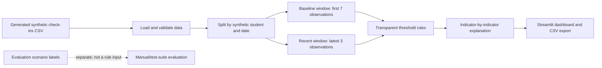

# MindCheck Week 1 Architecture

## Week 1 boundary

No hardware, cloud service, real student records, predictive-model training, or LLM is required for this milestone. The goal is a simple and inspectable end-to-end software proof-of-concept.
